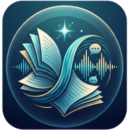
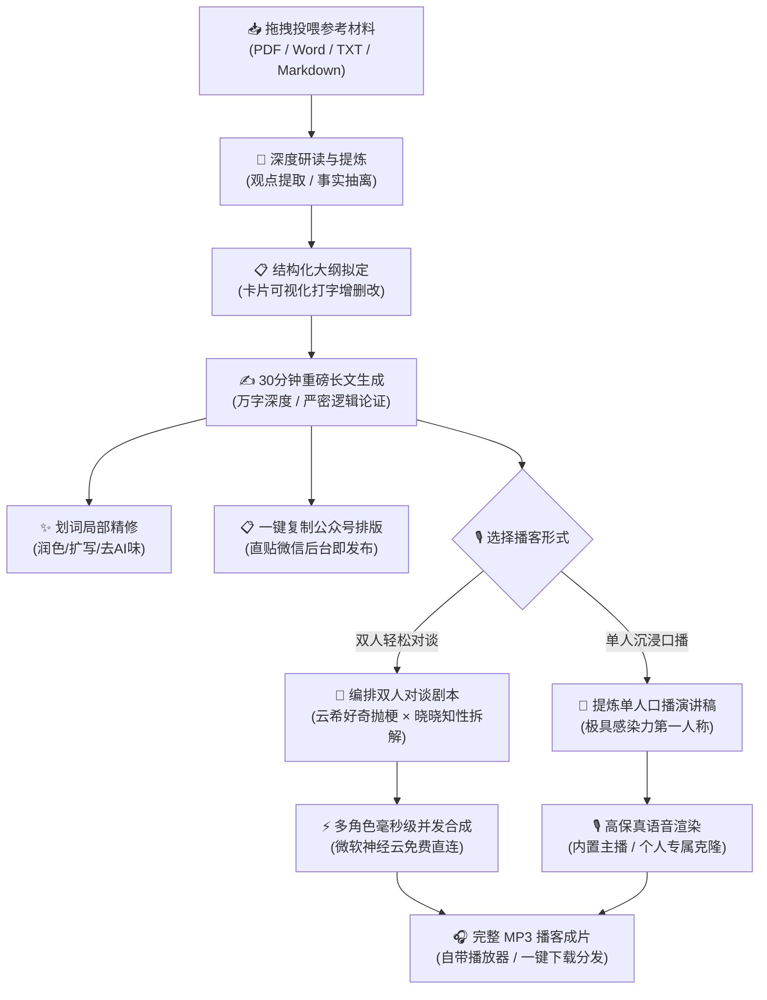

<p align="center">
  
</p>

# 纸上回音 · Paper Echoes

<p align="center">
  <strong>“由纸而生，化言成声”</strong><br>
  <em>基于事实材料的流式长文本深度写作与双人沉浸对谈播客工坊 (NotebookLM Audio Overview Chinese Alternative)</em>
</p>

<p align="center">
  
  
  
  
  
</p>

---

## 🎨 应用徽标（Icon）视觉寓意

- **翻飞的书卷（Paper）**：象征厚重的原始材料与知识基底；
- **奔涌的青碧流光（Cyan Wave）**：象征从文字中抽丝剥茧提炼出的深刻逻辑与认知脉络；
- **回荡的金色声波（Echoes）**：象征多角色对谈与声音复刻，让思想不仅能被阅读，更能被聆听；
- **顶部的启明晨星（North Star）**：象征 AI 深度思考带来的反常识洞察与终极思辨。

---

## 📖 项目简介 (Overview)

**「纸上回音 (Paper Echoes)」** 是一款专为深度内容创作者、学者、行业分析师与知识博主打造的**基于事实材料的万字长文写作与双人对谈播客工坊**。

它摒弃了传统 AI 工具浮夸空洞的“打字机式聊天”，而是像一位挑剔严谨的资深主编与声音导演：
1. **深度研读材料**：基于投喂的书籍、研报、试卷与文档材料，先拟定结构化事实大纲；
2. **万字长文生成**：展开为一篇长达 **30 分钟深度沉浸阅读（万字级）** 的重磅长文，严格事实锚定；
3. **双人对谈播客**：一键将长文自动编排为类似 **NotebookLM Audio Overview** 的**男女声轻松对话播客（云希 × 晓晓）**，像两位好友在咖啡馆喝咖啡一样，用幽默接地气的闲聊拆解深度硬核知识！

> 💡 **项目团队**：柏雯博、兰欣（人工智能赛道比赛定稿作品）

---

## ⚡ 解决的核心痛点 (Pain Points Solved)

| 传统 AI 工具 / 常见方案痛点 | 「纸上回音」的解决方案 |
|---|---|
| **空洞注水，缺乏事实依据**：大模型脱离实际凭空编造数据与论据 | **严格材料事实锚定**：必须基于创作者上传的真实材料展开推导，无依据不立论 |
| **篇幅短小单薄，无法产出深度长文**：市面工具多输出几百字泛泛而谈 | **首创「时间维度」篇幅体系**：支持 **30 分钟长篇重磅博客（约 1.2 万字）**，详实充沛 |
| **单一口播枯燥沉闷，缺乏听觉吸引力**：传统语音合成只是单调读课文 | **双人轻松对谈播客（男女双播）**：一男一女两位 AI 主理人（云希 × 晓晓）幽默互动、互相抛梗、生动拆解 |
| **语音合成需要昂贵 Key 或网络受限**：依赖国外受限服务或高昂商业 TTS 计费 | **微软公共神经网络直连（免 Key · 免费）**：国内网络秒开，微软大厂生态买单，零门槛生成高品质音频 |
| **生硬机械的“AI套壳味”**：满屏廉价 Emoji、浮夸渐变和空洞排比句 | **去 AI 味的瑞士冷峻美学**：克制低饱和暗墨界面，去除一切幼稚符号，行文自然纯正 |
| **环境繁重，电脑带不动**：多数开源方案需安装 Docker、向量库或数 G 显存 | **17MB 单 EXE 极简桌面软件**：零复杂环境，全云端 API 赋能，双击即开，兼顾便捷与隐私 |

---

## 🔄 核心工作流 (Workflow)



---

## 🌟 特色亮点 (Highlights)

### 1. 👥 首创「双人轻松对谈播客」（中文版 NotebookLM Audio Overview）
两位好友一唱一和、在轻松闲聊中把深奥道理讲明白：
- **AI 自动角色分工**：
  - **[云希]（男声 · 好奇型主理人）**：活跃接地气、爱抛梗、负责替听众追问反常识疑点；
  - **[晓晓]（女声 · 深度观察员）**：知性敏锐、善用生动比喻解释底层逻辑。
- **极速并发合成技术**：
  - 系统使用 `asyncio.gather` 并发网络管线，将全剧本 20+ 轮交替对话在 **十几秒内** 多路并发合成完毕，并以毫秒级微小停顿自然缝合为一段完整的 MP3！

### 2. 🌐 零门槛大厂级音色（免 Key · 国内直连 · 微软买单）
- **完全免 API Key**：内置基于微软 Edge 全球 CDN 的高保真神经语音引擎（Azure Neural TTS 技术底层）；
- **国内网络秒开**：无需任何魔法或翻墙工具，普通家庭宽带、手机热点与公司内网秒级直连；
- **成本为零**：由微软公共阅读服务买单，创作者零成本畅听畅享。

### 3. ⏱️ 独创「时间计时」篇幅体系，专为万字重磅大作而生
传统工具死板地数“字数”，而「纸上回音」以真实人类感知为尺度：
- **`30 分钟 (长篇重磅博客 · 约 1.2 万字)`**：真正适合严肃思考、系统阐述行业逻辑与学术观点的出版级体量，AI 自动划分 6~8 个全景纵深章节，饱满展开因果机制；
- **`3 分钟 (轻量演示)`**：用于快速验证材料核心论点与逻辑闭环；
- 编辑器行标动态显示：`1,240 字 · 约 3 分钟阅读 / 5 分钟口播`，篇幅节奏一目了然。

---

## 🗂️ 仓库内容与文档导航 (Documentation)

- [📖 软件使用与上手指南](docs/USER_GUIDE.md)：桌面客户端启动、API 配置、四步创作法与声音克隆指引。
- [🎤 15分钟答辩讲稿与评委问答预案](docs/DEFENSE_SPEECH_AND_QA.md)：逐页答辩发言稿、时间对照表与 7 大核心硬核 Q&A。
- [📌 竞赛成果交付索引](docs/PROJECT_INDEX.md)：完整交付物清单与模块说明。
- [📊 答辩幻灯片 (PDF)](presentation/纸上回音_柏雯博%20兰欣.pdf)：15页全套高保真答辩演示文档。
- [📊 答辩幻灯片 (含演讲备注版 PPTX)](presentation/纸上回音_柏雯博%20兰欣_含演讲备注版.pptx)：内置逐页演说词与时间标记的 PPT 原稿。

---

## 💻 架构设计与技术栈 (Architecture)

```
Paper-Echoes/
├── assets/                                # 项目真实图标
│   ├── icon.ico                           # 官方应用原生 Windows 图标
│   └── icon.png                           # 高清渲染图标 (PNG 256x256)
├── docs/                                  # 详细文档与指南
│   ├── USER_GUIDE.md                      # 软件使用与上手操作手册
│   ├── DEFENSE_SPEECH_AND_QA.md           # 15分钟答辩发言稿与全景问答预案
│   ├── PROJECT_INDEX.md                   # 成果与交付文件清单
│   └── 纸上回音_15分钟答辩发言稿与评委问答汇总.docx
├── presentation/                          # 答辩幻灯片与演示材料
│   ├── 纸上回音_柏雯博 兰欣.pdf            # 15页答辩幻灯片高保真导出版
│   └── 纸上回音_柏雯博 兰欣_含演讲备注版.pptx # 内置逐页演讲备注版 PPTX
└── README.md                              # 项目说明主文档
```

- **前端架构**：原生轻量 WebView2、HTML5、CSS3（暗夜青金冷峻美学）、Vanilla JS
- **长文管线**：支持 DeepSeek-V3/R1、Qwen、Kimi、GLM 模型热插拔
- **音频引擎**：Edge-TTS 异步并发语音流、CosyVoice 零样本声音复刻

---

## 📄 开源许可证 (License)

本项目基于 [MIT License](LICENSE) 开源。
